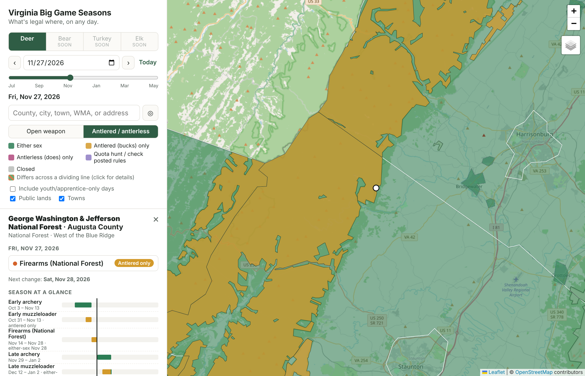

# Virginia Hunting Seasons Map

An interactive map of Virginia big game hunting regulations. Pick a species, a date (defaults to
today), and a place — county, city, town, public land, or street address — and see what is legal
there: which weapon seasons are open, whether it is an either-sex day, bag limits, Earn-a-Buck,
antler point restrictions, bonus-permit validity, and dog rules.



**Status:** Big game, small game, furbearers, and migratory game birds for the 2026–27 license year (migratory birds 2026–27 only), with 2025–26 and 2024–25 archived, plus local firearm ordinances and mapped ordinance areas. See [docs/ROADMAP.md](docs/ROADMAP.md).

> Unofficial. Regulations are summarized from
> [Virginia DWR's published regulations](https://dwr.virginia.gov/hunting/regulations/). Always
> confirm with the official regulations, posted property rules, and local ordinances.

## Quick start

```bash
npm install
npm run dev        # http://localhost:5173
npm test           # rules-engine + data-integrity tests
npm run build      # static site in dist/ (deployable anywhere, e.g. GitHub Pages)
```

**Basemap key (optional).** The default "Light" basemap is CARTO's, which needs an API key. Put it in
`.env.local` (git-ignored) as `VITE_CARTO_KEY=...` for local development, and as a repository secret
named `CARTO_KEY` for the GitHub Pages build. Without a key the map uses OpenStreetMap tiles. The key
is visible to anyone using the deployed site (tile keys are sent from the browser), so restrict it
to your site's domain in the CARTO dashboard.

The processed map layers in `public/data/` are committed, so you don't need to rebuild them to
run the app. To refresh them from the source agencies:

```bash
npm run fetch:sources   # downloads raw boundaries into sources/geo (git-ignored) + DWR pages into sources/regs
npm run build:geo       # simplifies/clips/splits them into public/data/*.geojson (mapshaper + Python: pip install -r scripts/requirements.txt)
```

## How it works

```
sources/regs/*.html        snapshot of the DWR regulation pages (diff these each license year)
src/regs/*-2026.ts         2026–27 regulations (big game, small game, furbearers) as declarative rules
src/regs/local*.ts         local firearm ordinances (text + hand-reviewed map effects)
src/regs/engine.ts         evaluates (place, date) against the rules
src/regs/virginia.ts       Blue Ridge east/west, independent-city → county, split jurisdictions
public/data/*.geojson      counties + independent cities, towns, public lands (split by county)
src/map.ts, src/main.ts    Leaflet map, controls, search
src/details.ts             the location panel (open seasons, season timeline, place facts)
tests/                     scenario tests ("Craig County National Forest on Nov 27 is either-sex",
                           "Roanoke County bear hounds vary south of I-81")
```

### The regulation model

Virginia's regulations vary along three axes at once, which is what makes them confusing:

1. **Jurisdiction** — county, independent city, or incorporated town (plus a few counties split by
   a road or line, e.g. Rockingham at Routes 613/731).
2. **Land type** — private land vs. National Forest, DWR WMAs, state forests/parks, Army Corps land.
   Many public properties have their own season dates and either-sex days.
3. **Date** — archery, muzzleloader, firearms, urban archery, and antlerless-only seasons, each with
   its own either-sex days.

Each rule in `deer-2026.ts` is a season (or either-sex-day list, or place fact) plus a `where`
selector, e.g.:

```ts
pf(['Henry', 'Patrick'], ['11-14', '12-12'], [d('11-21'), d('11-28'), ['11-30', '12-12']])
```

The engine resolves a clicked point to a `Place` (`{ county, city?, town?, land, property?,
region }`), finds every matching rule, and reports what's open on the chosen date. Public land
not named in DWR's tables falls back to a per-land-type policy (follow private-land seasons, or
"check posted rules", or closed for National Park Service land).

Where the regulations are ambiguous, the literal reading is encoded and the question is logged in
[docs/OPEN-QUESTIONS.md](docs/OPEN-QUESTIONS.md).

### Each new license year (and archiving the old one)

Regulations are keyed by license year (Jul 1 – Jun 30), so past years stay available once a new
year is added. Any date can be picked: if the app has no regulations for that date's license year
(an earlier year, or a year DWR hasn't published or that hasn't been added yet), a notice under the
date says so and links to DWR, and the map shows no seasons rather than another year's rules.
Dates in a loaded past year show an "Archived" notice.

**Watching for changes.** `.github/workflows/watch-dwr.yml` runs every Monday April–September (and
on demand from the Actions tab). It runs `scripts/check-dwr-changes.py`, which compares the text of
113 DWR pages (species pages, legal use, all local ordinance pages) with the snapshots in
`sources/regs/`, and opens — or comments on — a GitHub issue labelled `dwr-changes` with the diffs.

**When DWR publishes a new year:**
1. `python3 scripts/check-dwr-changes.py --update` to refresh the snapshots; review `git diff sources/regs/`.
2. Copy each `src/regs/*-2026.ts` to `*-2027.ts`, apply the changes, set `licenseYear: 2027`, and
   register them in `src/regs/index.ts` (keep the 2026 entries — that's the archive).
3. Re-extract changed local ordinance pages (`scripts/build-local-ordinances.py`) and review
   `src/regs/local-effects.ts`.
4. Add scenario tests for the new year; `npm test` also checks every referenced place exists.

## Data sources

| Layer | Source |
| --- | --- |
| Counties & independent cities, towns | U.S. Census Bureau cartographic boundary files (2023, 1:500k) |
| Split lines (Rts. 613/731, Dismal Swamp line, I-81, Rt. 16, Rt. 21, New River, Cripple Creek, Norfolk Southern main line, US 29, Rt. 151) | U.S. Census Bureau TIGER/Line roads, linear water, and rails (2023) |
| National Forest | USDA Forest Service, Basic Ownership (EDW) |
| Wildlife Management Areas | Virginia DWR, WMA Boundaries feature service |
| State forests, state parks, Philpott & Flannagan | Virginia DCR, Conservation Lands |
| National Park Service units | NPS Land Resources Division boundaries |
| Basemaps | OpenStreetMap; Esri World Topo / World Imagery |
| Address search | OpenStreetMap Nominatim |
